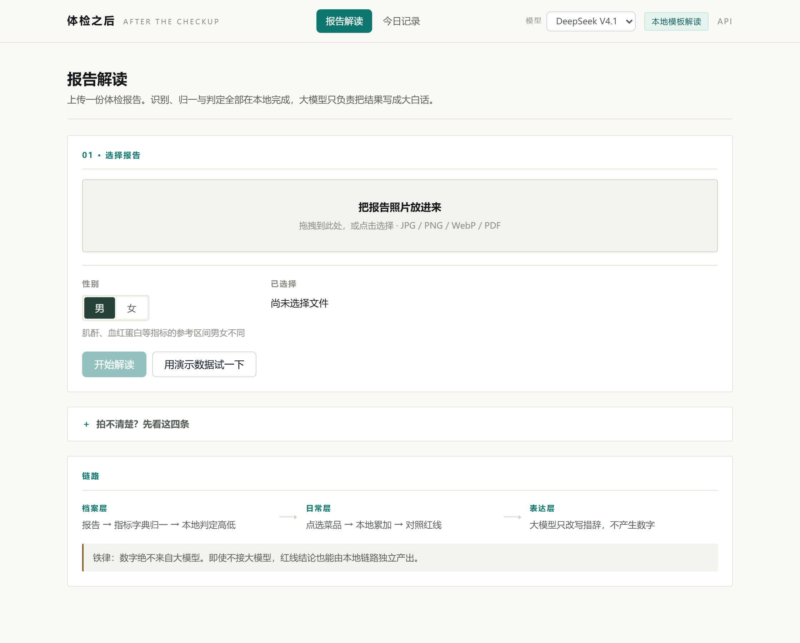
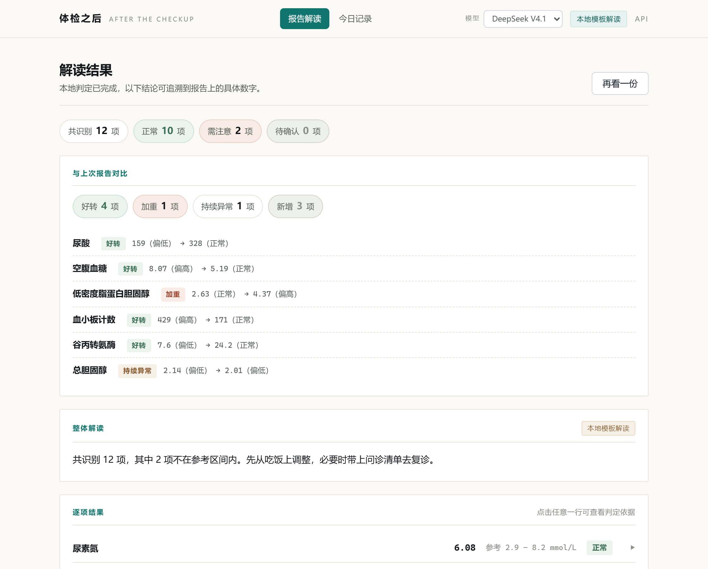
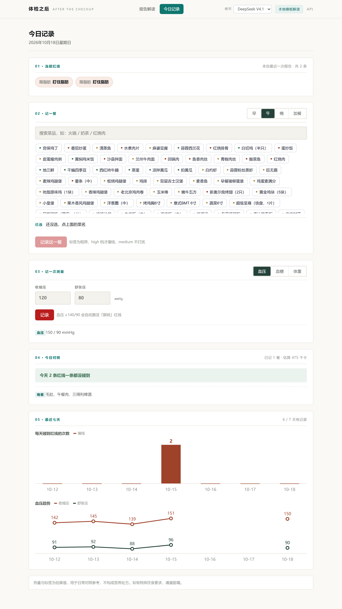

# 体检之后 —— 从体检报告到日常健康的家庭助手

   

> **体检只占一年中的一天，剩下 364 天才是这个产品的地盘。**

> ⏳ **当前状态（Day 1 · 2026-10-15）：选题已定，尚未动工。**
> 本 README 是立项版，主体内容是已锁定的技术决策与开发计划，**将随开发逐日替换为真实产出**。
> 距省赛作品提交（2026-11-18）**34 天**。

---

## 阅读路径

| 你想做什么 | 去哪 |
|---|---|
| 10 分钟跑起来 | [第三章｜Quick Start](#三10-分钟跑起来) |
| 查评分维度的证据 | [第九章｜评审证据索引](#九评审证据索引) |
| 看懂设计取舍 | [第五章｜架构](#五架构设计) + [第六章｜知识库](#六三大知识库) |

---

## 一分钟看懂：产品会长什么样

**首页**（上传入口 + 三层链路示意，工具型布局，无营销落地页）：



**解读结果**（概览 chips → 逐项结果 → 日常红线 → 问诊清单 → 给爸妈说的话）：



**今日记录**（红线对照 → 点选记餐 → 测量记录 → 一周趋势）：



> 截图为演示模式（`/api/demo` 现场合成的报告）的真实运行结果，非设计稿。

```
上传体检报告  →  抽出「你的三条红线」  →  每天勾一下吃了什么  →  今天碰了几条线
```

| 画面 | 状态 |
|---|---|
| 主界面：上传 + 解读结果（红线卡片 / 问诊清单 / 给爸妈的话） | `[x]` 已上线（见上方截图） |
| 处理过程：七阶段进度 + 思考过程可视化 | `[x]` 已上线 |
| 勾选菜品 → 即时显示碰了几条红线（动图） | `[ ]` 日常层开发后补 |
| 演示视频（5-8 分钟） | `[ ]` 脚本已就位，见 `docs/演示视频脚本.md` |

---

## 一、问题：一天与 364 天

父母体检完拿到报告，上面一个箭头 `↑`。看不懂是什么意思，也不知道接下来该怎么吃。
报告被塞进抽屉，**接下来的 364 天照旧吃喝**——直到明年再体检一次。

断点不在"看不懂"，而在**不知道然后呢**。

| 现有方案 | 差在哪 |
|---|---|
| 体检报告解读工具 | 一年只用一两次，看完就走，**没有后续动作** |
| 饮食 / 热量记录 App | 在算热量，但**没有对照目标**——不知道自己该限什么 |

两者的缺口是同一处：**报告上的异常，从来没有流进日常。**

### 解法：让低频的报告和高频的日常互为理由

- **报告**定义「红线」（尿酸高、血压高、血脂高）→ 让日常记录有对照目标
- **日常**记录 → 让报告从"看完就扔"变成"管接下来 364 天"

### 两类用户

- **25-45 岁子女**：父母体检后需要长期关注。老人侧零学习成本——他不需要会用这个工具，照常吃饭、量血压即可
- **大学生本人**：自己体检 + 自己吃食堂。本项目开发者本人即属于这一类，测试数据与演示素材均来自真实场景

---

## 二、我们明确不做什么

这一节不是免责清单，是**设计决策**。知道在哪里停手，和产品能做什么同样重要。

| 明确不做 | 原因 |
|---|---|
| 不做疾病判断、不给医学结论 | 定位是「解读与提示」，而不是医疗判定 |
| **不做药物推荐、不做补剂建议** | 医学合规红线，主动砍掉 |
| 甲状腺相关指标不做饮食映射 | 碘的边界容易踩雷，直接转为问诊提示清单 |
| 不做用户认证 | 本地单机场景，用一张 `members` 表 + 页面切换即可，无需账号体系 |
| 不做跨年多份报告对比 | 日常数据本身就是高频趋势，不必等一年 |

> 把报告翻成人话的项目已经不少。**这个项目的工程诚实，体现在它知道在哪里停下来。**

---

## 三、10 分钟跑起来

### 3.1 前置条件

- Windows + Git Bash
- conda Python **3.11.15**（已实测）
- 一个 DeepSeek API Key
- 一个 OCR 服务 Key（选型评测后确定，见 [第六章](#六三大知识库)）

### 3.2 四步启动

> **Windows 用户更省事的办法**：仓库根目录有个 **`启动.bat`**，**双击即可**——
> 它会自动启动服务并打开浏览器，不用敲任何命令。要停止就直接关掉那个黑窗口。
>
> 下面四步是手动方式，供 macOS / Linux 用户或有自定义需求时使用。

```bash
# 1. 克隆
git clone https://github.com/hoanhkhai1hk-wq/chuanzhibei.git
cd chuanzhibei

# 2. 安装依赖
D:/aconda3/envs/hwh_ml/python.exe -m pip install -r requirements.txt

# 3. 配置环境变量
copy .env.example .env          # Windows
# cp .env.example .env          # macOS / Linux
# 然后填入 DEEPSEEK_API_KEY

# 4. 启动
D:/aconda3/envs/hwh_ml/python.exe -m uvicorn app.main:app --reload --port 8000
```

打开 `http://127.0.0.1:8000`，交互 API 文档在 `/docs`。

> ⚠️ **为什么要写 Python 绝对路径**：本机存在多个 Python 环境（conda `hwh_ml`、`myenv`、托管 Python 3.13），
> 直接写 `python` 极易装到空环境里。**请按你的实际环境路径替换。**

### 3.3 本机环境坑（已实测，复现时先看这里）

| 坑 | 对策 |
|---|---|
| 本机有 HTTP 代理，访问 127.0.0.1 会被拦截返回 502 | `curl` 必须加 `--noproxy '*'`；浏览器给 localhost 加代理例外 |
| 用 `&` 起的后台进程会被回收 | 长驻服务需用后台任务方式运行，不要用 `&` |
| OpenCV 不支持中文路径且**静默失败** | 写盘改用 `cv2.imencode` + Python `open(path,'wb')` |

### 3.4 端到端验收链路

`[ ]` **TODO(Day 15)** —— 这条链路同时也是「端到端丑链路」的验收标准，Day 1 先把标准钉死：

```
上传一份体检报告 → 取回异常项 JSON  → 生成「你的三条红线」
                → 记一顿饭（勾选菜品）→ 取回今日「碰了几条红线」
```

### 3.5 当前已完成的部分

- `[x]` 选题与技术栈已锁定
- `[x]` Python 环境与依赖清单已实测核验（见 `requirements.txt`）
- `[x]` `app/schemas.py` 数据契约已落地：19 个模型，已通过导入验证与架构铁律自检
- `[x]` FastAPI 骨架可启动：`/health`、`/docs`、`/api/contract/sample` 已实测可用
- `[x]` 指标字典 **80** 条 + 红线规则 16 条，含交叉引用校验
- `[x]` **端到端链路已跑通**：图片 → OCR → 脱敏 → 解析 → 本地判定 → 红线
  （12 份合成样本验证，字典命中率 100%，触发 12 条红线）
- `[x]` **真实报告实测已完成**：8 张真实报告图跑完整链路。
  首轮命中率只有 **15%**（合成样本的 100% 是开卷考试），定位到五个真实版式问题
  并逐个修复后升到 **92%**，判定可用率 100%；其中 5 份真实报告的指标行
  **全部命中、全部可判定，并实际触发日常红线**。
  最大的一个坑是照片方向——曾被误诊为"双栏排版跨栏读取"，
  实为旋转后 OCR 串不成行（详见文档第二节的误诊记录）。
- `[x]` **定性指标判定修复**：「阴性（-）」——中国检验报告上最常见的定性写法——
  此前会被判成「待确认」，而「阳性（+）」却能正确识别（两边不对称）。
  现按括号内的符号优先判定，并支持半定量写法（尿蛋白 `2+`、`±`）。
  完整过程、数据表与仍未解决的短板见
  [tests/ocr_bench/results/真实样本实测.md](docs/真实样本实测.md)
- `[x]` **表达层已落地（模板模式）**：无 API Key 也完整可用——逐项解释来自指标
  字典的 `explain_high/low` 字段，问诊清单与「给爸妈说的话」由本地规则生成。
  配置 `DEEPSEEK_API_KEY` 后自动升级为大模型模式，输出须经**数字回溯校验**
  （用故意造假的假大模型验证过：无出处数字会被抓住并触发重跑，见 `tests/test_llm.py`）
- `[x]` **前端单页已上线**：上传 → 七阶段进度可视化（对应官方「思考可视化」
  评分点）→ 概览 chips → 逐项结果（可展开判定依据）→ 红线卡片 → 问诊清单 →
  给爸妈的话 → 脱敏原文回看。零构建、零 CDN 依赖，双击 `启动.bat` 即可复现。
  演示模式 `/api/demo` 现场合成本地报告，无需真实照片即可体验全流程
  （浏览器地址加 `?demo=1` 可自动跑一遍，演示视频与回归截图都用它）
- `[x]` **日常层已打通（Day 26-29 提前）**：菜品库 316 条（由种子表脚本化转换，
  含启发式六档标签与诚实边界声明）→ 点选记一餐 → 本地累加 → 对照当前红线即时撞线。
  SQLite 落库（stdlib sqlite3，WAL，零 ORM）；限酒红线因此新增 `alcohol` 标签档，
  不再错挂在脂肪上。补铁（boost）方向相反：吃到鸭血/肝脏记「达标」而非「超线」
- `[x]` **多报告趋势对比已打通**：每次解读落库时与上一份就地对比
  （保存的这一刻正好是"新报告已确认、旧报告未被覆盖"的唯一时机），
  结果页显示 好转/加重/持续/反转/新增 五种判定，口径与红线一致、全部本地计算。
  这也把"跨年多份报告趋势对比"从不做清单挪回了已完成——数据库铺好后它的边际成本几乎为零
- `[x]` **一周趋势曲线 + 测量记录已上线**：血压/血糖/体重录入，
  血压 ≥140/90（诊室标准）会**自动激活「限钠」红线**——报告里没有血压值（它是测量值
  非检验项），这条红线只能由日常层触发。周报用同一套聚合逻辑取最近 7 天：
  撞线次数柱图 + 血压双折线（手绘 SVG，零图表库；缺失日断线，不画出不存在的趋势）
- `[ ]` 演示视频尚未录制（脚本已就位：`docs/演示视频脚本.md`）；字典已达 80 条，可按真实报告继续扩
  （见 [第七章](#七功能清单与实现状态)）

> 大模型的定位是**增强而非依赖**：模板模式下产品已完整可用；
> 接入大模型后，数字仍由本地链路定稿，模型只改写措辞。见 [5.3 节](#53-架构铁律数字绝不来自大模型)。

---

## 四、项目结构

标注 `[x]` 的已创建，其余为计划中：

```
.
├── app/
│   ├── main.py              # [x] FastAPI 入口：extract → analyze → explain 三段式 + SSE 流式
│   ├── schemas.py           # [x] Pydantic 数据契约（含 is_likely_normal / disclaimer）
│   ├── pipeline.py          # [x] 端到端链路：图片 → 脱敏 → 解析 → 红线
│   ├── ocr/
│   │   ├── engine.py        # [x] OCR 适配层（rapidocr 默认，可换 paddle / baidu）
│   │   └── parser.py        # [x] 文本 → 四元组
│   ├── dict/
│   │   ├── markers.json     # [x] 指标字典 80 条（血常规/肝肾/血脂/电解质/甲功/尿常规/心肌酶）
│   │   ├── dishes.json      # [x] 菜品库 316 条（种子表脚本化转换，六档标签）
│   │   ├── build_dishes.py  # [x] 种子表 → 菜品库转换脚本（可重跑）
│   │   └── validate.py      # [x] 交叉引用校验
│   ├── rules/
│   │   ├── redlines.json    # [x] 红线规则 16 条
│   │   └── engine.py        # [x] 本地判定引擎（不调用大模型）
│   ├── daily/
│   │   └── service.py       # [x] 日常层：点选菜品 → 本地累加 → 红线撞线
│   ├── history.py           # [x] 多报告趋势对比（好转/加重/持续/反转/新增）
│   ├── data/
│   │   └── db.py            # [x] SQLite 落库（stdlib，WAL，零 ORM）
│   └── llm/
│       └── explainer.py     # [x] 表达层：模板模式（无 Key 可用）+ 大模型模式 + 数字回溯校验
├── static/
│   ├── index.html           # [x] 前端单页（零构建、零 CDN）
│   ├── style.css            # [x] 设计系统
│   └── app.js               # [x] 阶段进度 + SSE 流式渲染 + 今日记录 Tab
├── data/                    # SQLite 单文件（已 gitignore：健康数据不入 git）
├── docs/
│   └── prompt-log/          # ≥3 段核心 Prompt 链快照
├── 参考数据/                 # MIT 种子表（见第十一章）
└── tests/
    ├── test_rules.py        # [x] 规则引擎 41 项断言
    ├── test_e2e.py          # [x] 端到端 177 项断言（12 份合成样本）
    ├── test_llm.py          # [x] 表达层 33 项断言（含幻觉抓取验证）
    ├── test_daily.py        # [x] 日常层 20 项断言（撞线方向 / medium 不打扰）
    ├── test_history.py      # [x] 多报告对比 20 项断言（五种判定 + 路径防回归）
    ├── test_week.py         # [x] 周报与测量 28 项断言（血压阈值 / 红线激活）
    └── ocr_bench/           # [x] OCR 选型评测 + 合成报告生成器
```

---

## 五、架构设计

### 5.1 三层架构

```
【档案层 · 低频】体检报告 → OCR → 指标字典归一 → 本地判定 ↑↓ → 个人红线档案
【日常层 · 高频】每日记录 → 菜品库 / 数值 → 本地累加 → 对照红线 → 今日提示 / 周报
【表达层 · LLM】把「记了什么 + 碰没碰红线」写成一句人话 / 周报 / 给爸妈说的话
```

### 5.2 一条管线，两个字典，一套规则引擎

报告处理与饮食处理**复用同一条** `抽取 → 归一 → 判定 → 表达` 流程，**只换字典**。
这既是代码复用，也是「工程质量与架构设计」的着力点。

### 5.3 架构铁律：数字绝不来自大模型

这是全项目最关键的一条约束：

- **营养数值本地累加**，指标高低**本地查字典判定**，大模型只负责写成人话
- 输出做**数字回溯校验**：不在事实 JSON 中的数字，判为幻觉并重跑
- **隐私脱敏**：OCR 之后先抹掉姓名 / 身份证 / 医院 / 医生 / 体检号，**再**送入大模型

### 5.4 结构化输出契约

借鉴 `hkpritiranjan/explain-my-lab-report`（MIT），四个设计细节：

| 设计 | 为什么 |
|---|---|
| `is_likely_normal` 而非 `is_normal`，三值 `yes/no/unknown` | **把免责写进字段名**，而不是事后补一句话 |
| `reference_range: Optional[str] = None` | 承认 OCR 会失败，而非假装总能拿到 |
| `recommended_next_step` 挂在单个指标上 | 每个指标都有各自的下一步动作 |
| `disclaimer` 是结构体必填字段 | 合规不是界面上贴一行字，而是数据契约的一部分 |

---

## 六、三大知识库

项目真实的技术含量在这里，而不在代码行数上。

### 6.1 指标字典（目标约 120 项）

字段：标准名 / 中文别名 / 单位 / 成人参考区间 / 解读模板 / **红线映射列（自建）**

- 种子：`参考数据/指标参考区间_种子表.md`（149 行 / 78 条 / 10 个 Panel）
- 需要补：中文别名（`WBC` → 白细胞计数）、性别分层、中国医院常见单位
- **兜底原则**：以真实体检报告上的印刷区间为准，种子表只用于别名映射与缺项兜底

### 6.2 红线映射规则（10-15 条，完全自研）

这部分没有现成来源，是本项目最主要的原创资产：

| 指标异常 | 日常红线 | 典型触发食物 |
|---|---|---|
| 尿酸 ↑ | 限嘌呤 | 动物内脏、部分海鲜、浓汤 |
| 血糖 / HbA1c ↑ | 控精制碳水 | 白米饭、甜饮、糕点 |
| 血压 ↑ | 限钠 | 腌制品、酱料、加工肉 |
| TC / TG / LDL ↑ | 限脂肪 | 油炸、肥肉、动物油 |
| Hb ↓ | 补铁 + 维C | 红肉、动物血、菠菜 + 橙子 |
| ALT / AST / GGT ↑ | 限酒精 | 各类酒精饮品 |
| 肌酐 ↑ | 控蛋白总量 | 大量红肉、蛋白粉 |

> 甲状腺相关不做映射——碘的边界难以安全把控，直接转为问诊提示。

### 6.3 菜品库（目标 60-100 道）

字段：热量 + **钠 / 糖 / 嘌呤 / 脂肪** 四档标签

- 种子：`参考数据/中国品牌食品营养_种子表.md`（611 行 / 391 条 / 6 大品类）
- 需要自补：食堂菜 40-60 道、高嘌呤食物清单约 40 种、高 GI 食物约 20 条

> **一个必须提前知道的数据缺口**：《中国食物成分表》**不含嘌呤数据**，
> 而尿酸红线完全依赖它。因此高嘌呤清单需要另行整理。

---

## 七、功能清单与实现状态

| 优先级 | 功能 | 状态 |
|---|---|---|
| P0 | 上传报告 → OCR → 异常项高亮 | `[x]` 档案层 + 前端结果页已上线 |
| P0 | **生成「你的三条红线」**（本项目核心新增） | `[x]` 本地规则引擎 + 红线卡片 |
| P0 | **「给爸妈说的话」** | `[x]` 模板生成，一键复制 |
| P0 | 日常饮食记录：点选菜品 → 即时显示碰了几条红线 | `[x]` 菜品库 316 条 + 即时对照 |
| P0 | 今日提示 + 一周周报曲线 | `[x]` 撞线柱图 + 血压折线 |
| P1 | 血压 / 血糖记录（复用同一数据结构） | `[x]` 录入 + 血压自动激活限钠红线 |
| P1 | 指标卡片（正常区间条 + 你的位置标记） | `[ ]` |
| P1 | 导出图片 / PDF | `[ ]` |
| P0 | **跨年多份报告趋势对比** | `[x]` 保存时自动对比，五种判定口径 |
| P2 | 拍照识别菜品（识别失败自动退回点选） | `[ ]` |
| P2 | 家人档案（`members` 表切换，无账号） | `[ ]` |

### 为什么主输入是「点选」而不是「拍照」

食堂就那么几十道菜，做成可搜索的菜品库勾一下即可，30 秒完成。
拍照识别只作为增强功能，**识别不准不影响主流程**——这条设计规避了对视觉模型准确率的依赖。

---

## 八、AI 协同与 Prompt 工程

本项目为 **Vibe Coding** 产物：前端与大部分代码由 AI 生成；
人的工作是**定义数据契约、编写知识库、设计判定规则、校验 AI 输出**。

### Git 演进策略

- 采用 **Phase 制**：每个阶段一个 PR + 一次 merge + 一条完整 commit message
- 关键 commit 标注 `Co-Authored-By`，AI 协同的记录直接留在提交历史里
- 目标约 **20 次有意义的提交**，不凑数

### Prompt 链快照索引

`[x]` 已产出（见 `docs/prompt-log/`）：

| 编号 | 主题 | 产出落点 |
|---|---|---|
| [PL-01](docs/prompt-log/01-立项与意图对齐.md) | 立项：选题调研、两次否决与 v2 定案 | README / 调研文档 |
| [PL-02](docs/prompt-log/02-端到端串联.md) | 档案层：端到端串联与"自洽性检查"测试策略 | `app/pipeline.py` |
| [PL-03](docs/prompt-log/03-表达层与数字回溯.md) | 表达层 Prompt 全文 + 数字回溯校验设计 | `app/llm/explainer.py` |

> 每篇保留用户原话、给 AI 的约束、产出与复盘——意图对齐的深度在"否决了什么"里，
> 不在"做了什么"里。

---

## 九、评审证据索引

### 9.1 赛道符合性声明

本作品参赛赛道为 **「全国高校 Vibe Coding 开发挑战赛」**，核心主题
「重塑范式：基于 Vibe Coding 的全栈应用速成挑战赛」。

**范式**：全部代码由 AI 生成，人负责定义数据契约、编写知识库、设计判定规则、校验 AI 输出。
这正是赛题要考察的「AI 编写代码，人类引导意图」。

**选题归属**：官方给出 10 个推荐选题方向。本作品归属于第 6 条
「校园 / 垂直社区全栈 MVP 平台」——面向特定群体的真实痛点，具备完整增删改查与数据流转的
Web 应用。本作品的目标群体为 25-45 岁子女与大学生本人，数据流转贯穿档案层与日常层。

**四项核心能力对照**：

| 赛题要求的能力 | 本作品的做法 |
|---|---|
| AI 协同与意图对齐 | 数据契约先行（`app/schemas.py`），用结构化输出约束模型，而非靠反复试 prompt |
| 工程架构与黑盒掌控力 | 一条管线、两个字典、一套规则引擎；`/api/extract` 与 `/api/explain` 分离编排 |
| 过程鲁棒性与可复现性 | Phase 制提交 + Prompt 链快照 + 数字回溯校验 |
| 敏捷交付与产品闭环 | 报告 → 红线 → 日常记录 → 周报 → 给爸妈说的话，链路闭合 |

### 9.2 评分维度对照

| 评分维度 | 权重 | 本项目的做法 | 证据位置 |
|---|---|---|---|
| 过程可复现性与演进链路 | 25% | Phase 制提交 + `Co-Authored-By` + ≥3 段 Prompt 链 | 第八章 · `docs/prompt-log/` |
| 解题有效性与实用价值 | 25% | 一天 vs 364 天；两类真实用户 | 第一章 |
| 方法创新性与意图控制 | 20% | 数字不上大模型 + 回溯校验 + 隐私脱敏 | [5.3 节](#53-架构铁律数字绝不来自大模型) |
| 工程质量与架构设计 | 15% | 一条管线两个字典；`/extract` 与 `/explain` 分离 | [第四、五章](#五架构设计) |
| 用户体验与产品精细度 | 15% | **流式响应与思考可视化**（赛题明确点名）、概览色块、话术柔化 | [第七章](#七功能清单与实现状态) · `StreamEvent` |

---

## 十、开发路线图

Day 1 = 2026-10-15，共 34 天。

| 阶段 | 天 | 任务 |
|---|---|---|
| 立项 | 1-2 | 建仓、README、确认本校截止日与缴费 |
| **OCR 选型评测** | **3-5** | 用 10-15 份真实报告做字段级评测后选型（**框架已建**，见 `tests/ocr_bench/`） |
| 指标字典 + 红线规则 | 6-9 | 约 120 项字典 + 10-15 条红线映射 |
| 菜品库 | 10-12 | 60-100 道菜的四档标签 |
| **端到端丑链路** | **13-15** | ✅ **已跑通**（12 份合成样本验证，界面仍待开发） |
| 大模型链路 | 16-19 | Prompt、结构化输出、数字回溯校验 |
| 前端 | 20-24 | 上传、红线卡、饮食记录、周报 |
| 亮点功能 | 25-28 | 给爸妈说的话、血压记录、导出 |
| 材料 | 29-32 | 演示视频、技术文档 |
| 缓冲 | 33-34 | 复现性自检、提交 |

**范围失控时的砍功能优先序**：砍血压记录 → 砍拍照识别 → 菜品库缩到 40 道。

### OCR 选型：先测再选，不猜

`tests/ocr_bench/` 已经搭好了评测框架，**它比写代码优先级更高**——
OCR 是本项目的头号技术风险，抽不准数字，后面全建立在错的基础上。

```
python tests/ocr_bench/bench.py --selftest        # 先确认脚本本身正常
python tests/ocr_bench/synth.py --count 12 --degraded 4   # 生成合成样本
python tests/ocr_bench/bench.py --provider all
```

评测分两层：**L1 文本准确率** + **L2 四元组召回率**（指标名/数值/单位/参考区间）。
三家 provider **共用同一个解析器**，这样比的是 OCR 本身，而不是谁家的解析器写得好。

选型的判断标准不是总分，而是**最弱的那一项**——
尤其看 `ref`（参考区间）：区间判错，红线就判错，整套逻辑都会歪。

> **样本从哪来**：网上能找到的中文体检报告数据集都不满足「免费 + 可商用 + 已脱敏」
> （数据堂要付费、天池/启智是 CC-BY-NC、ClinOCR-Bench 是英文）。
> 因此本项目**自己合成**中文报告——中文、可控、合规、ground-truth 100% 精确，
> 并能模拟拍照退化。真实脱敏报告只需 1-2 份做最终确认。
> 详见 `tests/ocr_bench/README.md`。样本目录已被 `.gitignore` 排除。

> 本项目最大的风险不是技术，是**范围**。
> 两套字典 + 两套记录 + 规则引擎 + 大模型 + 前端，任何一环延期都会拖垮全局。
> **宁可窄而完整，不要宽而半成品。**

---

## 十一、数据来源与 License

### 参考的数据源

| 文件 | 来源 | License | 用途 |
|---|---|---|---|
| `参考数据/指标参考区间_种子表.md` | `H1an1/health-coach` 的 `references/medical-markers.md` | **MIT** | 指标字典种子 |
| `参考数据/中国品牌食品营养_种子表.md` | 同仓库 `references/cn-brands.md` | **MIT** | 菜品库种子 |
| `参考数据/营养计算_参考.md` | 同仓库 `references/nutrition.md` | **MIT** | BMR / TDEE 公式 |

感谢 `H1an1/health-coach`（MIT License）开放这些数据。本项目在其基础上做了中文别名补全、本地化校正，并新增了原表不具备的「红线映射」列。

### 参考的设计

- `hkpritiranjan/explain-my-lab-report`（MIT）：借鉴了其结构化输出契约设计，见 [5.4 节](#54-结构化输出契约)

### 本项目 License

MIT License，见 `LICENSE` 文件。

---

## 十二、免责声明

> **本项目不构成医疗建议，所有提示均应遵医嘱。**
>
> 所有判定均基于公开的成人参考区间，最终以你的体检报告印刷值为准。
> 项目只做「解读报告」与「对照提示」两件事，不做疾病判断，也不做药物推荐。

---

## 十三、已知限制

- OCR 对版式复杂的报告仍可能识别失败，届时提供手动校正入口
- 菜品库为抽样估算值，非称重实测
- 参考区间仅为成人通用值，不支持儿童、孕期等特殊人群
- 无多用户认证体系，设计为本地单机使用
- 红线映射规则覆盖约 7 类常见指标异常，非全部

---

## 十四、FAQ

**为什么不用拍照识别为主输入？**
食堂菜品有限且固定，点选更快更准。拍照识别准确率不稳定，让它做增强而非主干。

**为什么不让大模型判定指标高低？**
让模型记参考区间并做数值判定，等于把最不可靠的环节交给最容易出错的地方。判定放本地，模型只写人话。

**为什么不做一个 App？**
网页端无推送能力，而「提醒」恰恰是 App 的核心价值——既然做不到提醒，做网页更聚焦。

---

<div align="center">

第九届传智杯 · AI 创新应用挑战赛 · B 组

本项目持续更新中，README 随每日进展同步校准。

</div>
